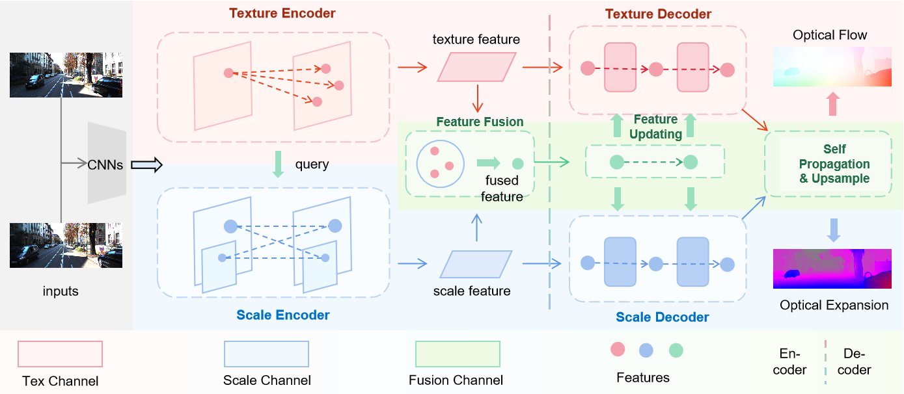
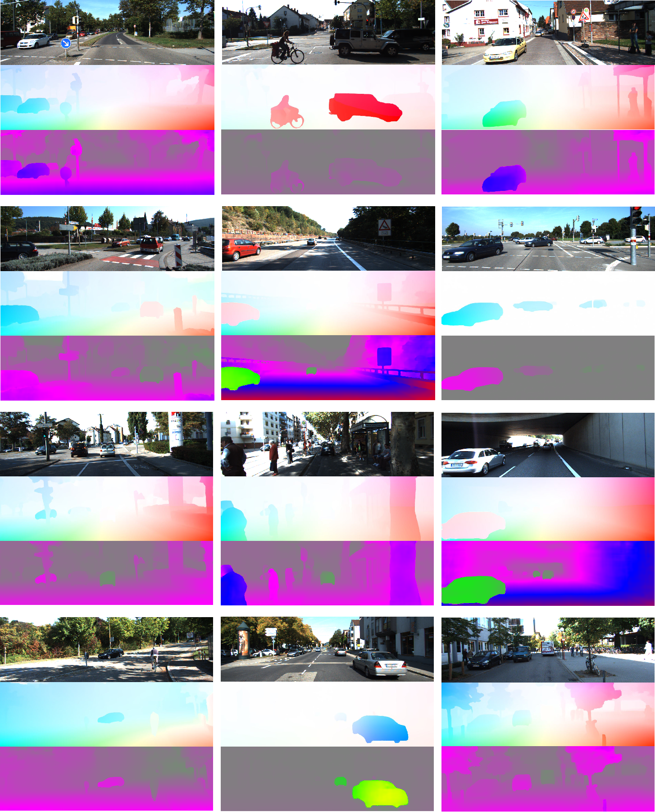

# Digging into Monocular Texture-Scale Feature Fusion for Optical Flow and Optical Expansion Estimation

Official implementation of "Digging into Monocular Texture-Scale Feature Fusion for Optical Flow and Optical Expansion Estimation". Submitted to T-PAMI on July **, 2024.




## Abstract

In this paper, we focus on monocular **optical flow (OF)** and **optical expansion (OE)** estimation. OF and OE describe the information changes in pixels caused by motion and are important perceptual tasks in computer vision and autonomous driving. Existing works are limited to extracting static features of the scene, with OF as the main optimization objective and OE as the auxiliary task. These methods do not fully consider the dynamic information of the scene and get low accuracy.
  In dynamic scenes, objects with their motion generates texture and scale feature during the projection process onto 2D images. Texture feature contains information such as color and shape, while scale feature describes the scale changes of objects projected onto pixels. This paper explores the interaction mechanism between texture and scale information in images, treating both OF and OE as core tasks that mutually enhance each other. We propose a novel pipeline, MonoFusion, which independently extracts texture and scale features and improves performance of OF and OE by feature fusion and updating. Additionally, we introduce MonoFusion-R, which further enriches the iteration process of texture-scale feature fusion with a novel recurrent framework. Our method achieves state-of-the-art (SOTA) performance on KITTI for optical flow, optical expansion, time-to-collision and scene flow estimation tasks.

## Setup

### Environment

Our experiments are conducted in Ubuntu20.04 with Anaconda3, Pytorch 1.12.0, CUDA 11.3, 3090 GPU.

1. create conda environment:

```shell
conda create -n monofusion python=3.8 -y
conda activate monofusion
```

2. install dependencies:

```
pip install torch==1.12.0+cu113 torchvision==0.13.0+cu113 torchaudio==0.12.0 --extra-index-url https://download.pytorch.org/whl/cu113
pip install -r requirements.txt 
```

3. clone our code:

```
git clone https://github.com/LChanglin/MonoFusion.git
```

4. download our pretrained weights from [link](https://drive.google.com/drive/folders/1ebfjezbP6rDpzH5ofFLMWLl50YtE8-kT).


### Datasets

Download FlyingThings3D and KITTI for training. 

```bash
Datasets
|-- flyingthings
|   |-- disparity
|   |-- disparity_change
|   |-- frames_cleanpass
|   `-- optical_flow
`-- kitti
    |-- data_scene_flow
    |   |-- testing
    |   `-- training
    |-- data_scene_flow_calib
    |   |-- testing
    |   `-- training
    `-- data_scene_flow_multi
    |-- testing
    `--training
```


## Usage

We use 3090 GPUs for training and testing.

### training

For regular training without depth supervision:

```bash
# train with our settings
# --resume: load with pretrained weights, used for finetuning (default:./pretrained/fpttc_mix.pth.tar)
# --epoch: training epoches
# --lr: learning rate: set as mentioned in out paper
# --image_size: resolution
sh train.sh
```

For training with depth supervision:

```bash
sh depth/train.sh
```


### inference with your own data

```bash
# test with our settings
# --resume: load with pretrained weights (default:./pretrained/fpttc_mix.pth.tar)
# --inference_dir: tested images
sh infer.sh
```


### evaluation

```bash
CUDA_VISIBLE_DEVICES=0 python evaluation.py \
--resume ./pretrained/[PRETRAINED WEIGHTS].pth.tar \
--inference_dir [PATH TO KITTI]/testing/image_2/
```

The evaluation results will be saved as npy.

Evaluation on KITTI are available at [KITTI sceneflow benchmark](https://www.cvlibs.net/datasets/kitti/eval_scene_flow_detail.php?benchmark=scene_flow&result=2efaab1112242238d8dec77411fb10e2df6e0e36).

| Pretrained Weights         | Training<br />Strategy          | $$F1_{all}$$ | $$MiD_{err}$$ |
| -------------------------- | ------------------------------- | ------------ | ------------- |
| monofusion_kitti.pth.tar   | MonoFusion finetuned on KITTI   | 4.48         | 42.60         |
| monofusion_r_kitti.pth.tar | MonoFusion-R finetuned on KITTI | 4.27         | 39.86         |
| monofusion_depth.pth.tar   | MonoFusion-R on Things          | 2.63         | - - -         |


## Visualization

KITTI:

