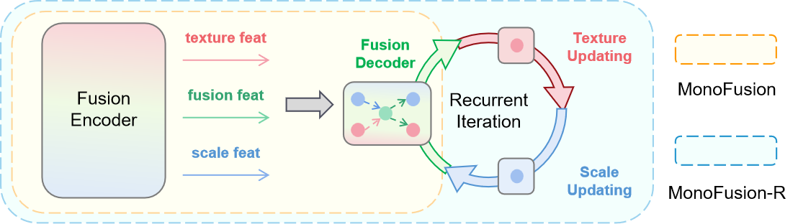

# MonoFusion / MonoFusion-R

> **Checkpoint update (October 17, 2026):** The updated checkpoints have been checked and are available from [Google Drive](https://drive.google.com/drive/folders/1ebfjezbP6rDpzH5ofFLMWLl50YtE8-kT). Both listed downloads were verified against the GPU-validated compatibility release and passed strict parameter loading. **Update this repository, download the new files into `pretrained/`, and run `submission.py` directly—no checkpoint conversion is needed.** The architecture is selected automatically from checkpoint metadata. See the [reproduction Skill](skills/monofusion-reproduce/SKILL.md), [Quick start](#evaluation--inference), and [download checksums and important notes](pretrained/README.md).

### Digging into Monocular Texture-Scale Feature Fusion for Optical Flow and Optical Expansion Estimation

**Changlin Li, Yeqiang Qian, Chunxiang Wang, Ming Yang**
Department of Automation, Shanghai Jiao Tong University

**IEEE Transactions on Pattern Analysis and Machine Intelligence (T-PAMI), 2026**

Official PyTorch implementation of **MonoFusion** and its recurrent variant **MonoFusion-R**: a texture-scale feature fusion pipeline that estimates monocular **optical flow (OF)** and **optical expansion (OE)** as two equally-important, mutually-reinforcing tasks, instead of treating OE as a by-product of OF.

<p align="center">
  
</p>

---

## Table of Contents

- [Highlights](#highlights)
- [MonoFusion vs. MonoFusion-R](#monofusion-vs-monofusion-r)
- [Repository Structure](#repository-structure)
- [Setup](#setup)
- [Datasets](#datasets)
- [Model Zoo](#model-zoo)
- [Training](#training)
- [Reproduction Skill](#reproduction-skill)
- [Evaluation & Inference](#evaluation--inference)
- [Results](#results)
- [Visualization](#visualization)
- [Citation](#citation)
- [Acknowledgements](#acknowledgements)

## Highlights

Existing dense optical-expansion methods derive expansion from optical flow, or estimate the two tasks from a largely shared representation, so OE accuracy is bottlenecked by OF quality. We instead treat **texture** (color/shape, driving OF) and **scale** (projected-size change, driving OE) as two independent, same-level feature streams that guide each other:

- **MonoFusion**: independently extracts texture and scale features and fuses/updates them with a dedicated fusion encoder-decoder, so optical flow and optical expansion mutually enhance each other instead of one being derived from the other.
- **MonoFusion-R**: wraps the same fusion encoder/decoder in a lightweight, weight-shared **recurrent loop** that progressively refines texture and scale features together, trading a few extra iterations for a sizeable accuracy gain (see [below](#monofusion-vs-monofusion-r)).
- State-of-the-art **monocular** results on four KITTI tasks — optical flow, optical expansion, time-to-collision (TTC), and scene flow — and strong optical-flow generalization on FlyingThings3D.

## MonoFusion vs. MonoFusion-R

MonoFusion-R reuses **every module of MonoFusion unchanged** (same fusion encoder, same fusion decoder, same weights). The only difference is *how many times* the fusion decoder is applied: each recurrent iteration (i) updates the scale-conditioned texture features via optical-flow warping, (ii) re-fuses texture and scale and re-estimates flow/expansion through the fusion decoder, and (iii) feeds the new estimate back into the next iteration — all iterations sharing the same weights (RNN-style), so no extra parameters are introduced.

<p align="center">
  
</p>

<p align="center"><i>Fig. MonoFusion-R: the Fusion Encoder feeds a recurrent loop of texture updating &rarr; feature fusion + OF/OE estimation &rarr; scale updating.</i></p>

Because the recurrent loop is weight-shared, the number of iterations is a pure **inference-time knob** exposed as `--num_iterations` (`MonoFusion.num_iterations` / `ScaleNet.num_iterations` in code) — no architecture change or extra parameters are required to move between MonoFusion (`--num_iterations 1`) and MonoFusion-R (`--num_iterations > 1`). Accuracy keeps improving with more iterations, at a modest speed cost, and already surpasses the strongest recurrent baseline (TPCV, 12 GRU iterations) after only 2-3 MonoFusion-R iterations:

| Iterations | F1-all&darr; | MiD-err&darr; | Time (ms) |
| :---: | :---: | :---: | :---: |
| 1 (MonoFusion) | 4.53 | 44.8 | 176 |
| 2 | 4.40 | 42.2 | 268 |
| 3 | 4.33 | 40.0 | 377 |
| **4 (MonoFusion-R)** | **4.27** | **39.9** | 620 |
| TPCV (12 GRU iterations) | 4.68 | 41.8 | 784 |

*Inference speed measured on a single NVIDIA RTX 3090 at 352&times;1216. See the paper (Table 7) for the full ablation, including recurrent-loop initialization.*

## Repository Structure

The main pipeline is organized as follows:

```
MonoFusion/
├── monofusion/                 # MonoFusion / MonoFusion-R model (used for OF / OE / TTC / scene flow on KITTI)
│   ├── model.py                #   top-level nn.Module (class MonoFusion)
│   ├── layers/                 #   shared building blocks: attention, matching, geometry, position, ...
│   └── network/                #   texture/scale encoders, fusion decoder, backbone
│       └── feature_net/        #     texture & scale transformer feature extractors
├── dataloader/                  # dataset loading & augmentation (FlyingChairs / FlyingThings3D / Driving / KITTI)
├── utils/                       # training loop (trainer.py), losses (loss.py), visualization (draw.py)
├── pretrained/                  # place downloaded checkpoints here
├── images/                      # figures used in this README
├── train.py / train.sh          # KITTI fine-tuning entry point
└── submission.py / submission.sh # inference / benchmark-submission entry point
```

> This structure replaces the original release's cryptic, experiment-suffixed names (e.g. `selfttc/scale_net_agg4gxr3/`, `self_ttc_agg4gxr3.py`) with names that describe what each module actually does. Directory renaming preserves parameter names, but some released checkpoints use an earlier single-channel scale decoder and do not match the current architecture. See [checkpoint compatibility](migration/USAGE.txt) before loading those weights.

## Setup

### Inference environment for the updated checkpoints

The compatibility release was validated with Python 3.13, PyTorch 2.10.0+cu128, and an NVIDIA RTX PRO 5000. A minimal Linux/CUDA environment is:

```bash
conda create -n monofusion-inference python=3.13 -y
conda activate monofusion-inference
pip install torch==2.10.0 --index-url https://download.pytorch.org/whl/cu128
pip install numpy Pillow opencv-python
```

For a different CUDA version or CPU installation, select the appropriate wheel from the [official PyTorch instructions](https://pytorch.org/get-started/previous-versions/#v2100). The main inference pipeline includes a native PyTorch deformable-attention fallback, so `mmcv-full` is not required for this workflow. The original CUDA extension is still used when available. Do not install the legacy training requirements into this minimal inference environment.

### Original experimental environment

Experiments were run on Ubuntu 20.04, Python 3.8, PyTorch 1.12.0, CUDA 11.3, NVIDIA RTX 3090.

```bash
conda create -n monofusion python=3.8 -y
conda activate monofusion

pip install torch==1.12.0+cu113 torchvision==0.13.0+cu113 torchaudio==0.12.0 --extra-index-url https://download.pytorch.org/whl/cu113
pip install -r requirements.txt
```

```bash
git clone https://github.com/LChanglin/MonoFusion.git
cd MonoFusion
```

### Datasets

Download [FlyingChairs](https://lmb.informatik.uni-freiburg.de/resources/datasets/FlyingChairs.en.html), [FlyingThings3D](https://lmb.informatik.uni-freiburg.de/resources/datasets/SceneFlowDatasets.en.html), [Driving](https://lmb.informatik.uni-freiburg.de/resources/datasets/SceneFlowDatasets.en.html) and [KITTI Scene Flow](https://www.cvlibs.net/datasets/kitti/eval_scene_flow.php) and arrange them as:

```
data/
├── flyingthings/
│   ├── disparity/
│   ├── disparity_change/
│   ├── frames_cleanpass/
│   └── optical_flow/
└── kitti/
    ├── data_scene_flow/
    │   ├── training/
    │   └── testing/
    ├── data_scene_flow_calib/
    │   ├── training/
    │   └── testing/
    └── data_scene_flow_multi/
        ├── training/
        └── testing/
```

## Model Zoo

Download the **updated, ready-to-use checkpoints** from [Google Drive](https://drive.google.com/drive/folders/1ebfjezbP6rDpzH5ofFLMWLl50YtE8-kT) into `./pretrained/`. File sizes, direct links, and SHA-256 checksums are listed in [`pretrained/README.md`](./pretrained/README.md).

| Checkpoint | Use with this release | Notes |
| --- | --- | --- |
| `monofusion_kitti.pth.tar` | `submission.py --num_iterations 1` | Single-pass optical flow and expansion inference |
| `monofusion_r_kitti.pth.tar` | `submission.py --num_iterations 4` | Recurrent optical flow and expansion inference |

Both verified downloads contain the same 387 trained parameter tensors (21,174,512 parameters), with per-file provenance metadata. They are compatible inference packages, not evidence of distinct training runs. `submission.py` automatically selects `legacy_scale` from the metadata and loads parameters strictly. These files are not drop-in checkpoints for the training scripts, which instantiate a different architecture.

The same parameter tensors passed GPU inference on 40 image pairs at both 1 and 4 iterations. This verifies compatibility and comparisons against historical prediction images; the paper's benchmark results in [Results](#results) have not been re-evaluated as part of this release. If you still have an older checkpoint without migration metadata, follow the [legacy conversion workflow](migration/USAGE.txt) instead of applying it to an already updated file.

## Training

The commands below describe the original training workflows and require checkpoints matching their model architectures. The updated `legacy_scale` downloads are verified for inference; the training scripts do not automatically select their architecture from migration metadata.

**1. Optical flow / scene flow.** Pretrain on FlyingChairs + FlyingThings3D (200k iters, lr 1e-4, batch size 4), then fine-tune on KITTI (50k iters, lr 5e-5, batch size 3):

```bash
# fine-tune on KITTI, starting from a FlyingThings3D-pretrained checkpoint
# --num_iterations 1 trains MonoFusion, --num_iterations 4 trains MonoFusion-R
MONOFUSION_TRAIN_CHECKPOINT=/path/to/matching-pretrained.pth.tar sh train.sh
```

**2. Optical expansion.** Following prior work, first train on the [Driving](https://lmb.informatik.uni-freiburg.de/resources/datasets/SceneFlowDatasets.en.html) dataset (100k iters, lr 1e-4), then fine-tune on KITTI (every 5th KITTI image held out for validation, 60k iters, lr 5e-5) by setting `--stage 'kitti'` (or `'driving'` for the first stage) in `train.sh`.

Key training flags (see `train.py --help` for the full list):

| Flag | Meaning |
| --- | --- |
| `--num_iterations` | number of MonoFusion-R recurrent iterations (`1` = MonoFusion) |
| `--resume` | checkpoint to initialize from (required unless `--load_flow_param` is set) |
| `--save` | output checkpoint path |
| `--stage` | training dataset: `chairs`, `things`, `driving`, `kitti`, `sintel`, ... (see `dataloader/dataset.py`) |
| `--image_size`, `--lr`, `--epoch`, `--batch_size` | standard training hyperparameters |

## Reproduction Skill

Use the bundled [**monofusion-reproduce Skill**](skills/monofusion-reproduce/SKILL.md) with a coding agent to download verified weights, prepare an inference environment, run the reported four-iteration configuration with a single-pass control, and evaluate the results. Give the agent the skill file and your repository/data paths, for example:

> Use `skills/monofusion-reproduce/SKILL.md` to reproduce MonoFusion's best reported inference configuration on my KITTI data at `/path/to/kitti/training`. Use an available GPU, compare 1 and 4 iterations on the agreed held-out split, and provide measured results and visual comparisons. Distinguish compatibility checks from official paper-score reproduction.

The Skill includes executable helpers:

```bash
# Download both inference packages and verify the pinned release hashes.
python skills/monofusion-reproduce/scripts/download_checkpoints.py --repo .

# After inference, evaluate raw flow predictions against KITTI ground truth.
python skills/monofusion-reproduce/scripts/evaluate_flow.py \
  --predictions output/monofusion_r \
  --ground-truth /path/to/kitti/training/flow_occ \
  --output output/monofusion_r_metrics.json
```

Use `--ids` with explicit scene IDs for a held-out subset. The evaluator reports local EPE and Fl-all; it does not measure optical-expansion MiD, TTC, or official test-server scores. Without ground truth, the Skill can compare against historical predictions or perform a smoke test and will report the remaining quality-validation gap. Four iterations are the strongest reported configuration, but the Skill checks whether they improve the supplied data rather than assuming they do.

## Evaluation & Inference

Update the repository and download the new checkpoints into `pretrained/` before running inference. No conversion or manual key editing is required for the updated downloads.

```bash
git pull --ff-only

# Single-pass inference
CUDA_VISIBLE_DEVICES=0 python submission.py \
  --resume ./pretrained/monofusion_kitti.pth.tar \
  --num_iterations 1 \
  --inference_dir ./data/kitti/data_scene_flow/testing/ \
  --output_path ./output/monofusion

# Recurrent inference
CUDA_VISIBLE_DEVICES=0 python submission.py \
  --resume ./pretrained/monofusion_r_kitti.pth.tar \
  --num_iterations 4 \
  --inference_dir ./data/kitti/data_scene_flow/testing/ \
  --output_path ./output/monofusion_r
```

`sh submission.sh` also runs the recurrent configuration. Use `--device cpu` for CPU inference, or set `CUDA_VISIBLE_DEVICES` to select a GPU.

The input directory must contain `image_2/*_10.png` and matching `*_11.png` files. Inference defaults to 352×1216; use `--inference_size H W` to override it, with both dimensions divisible by 32. Predictions are resized back to the original image size. `--max_samples N` limits the number of pairs for a quick check.

Outputs include raw flow/scale `.npz` files, KITTI-format flow PNGs under `submit/flow/`, and colorized visualizations. Scene-flow disparity exports additionally require external disparity files at `disp_ganet_testing/*_10.png` inside the input directory. Without them, the script produces flow and expansion only. Submit complete scene-flow predictions to the [KITTI benchmark](https://www.cvlibs.net/datasets/kitti/eval_scene_flow_detail.php?benchmark=scene_flow&result=2efaab1112242238d8dec77411fb10e2df6e0e36) for official scores.

For custom Python inference, select the architecture from the checkpoint metadata:

```python
import torch
from monofusion.model import MonoFusion

checkpoint = torch.load("pretrained/monofusion_kitti.pth.tar",
                        map_location="cpu", weights_only=True)
model = MonoFusion(num_scales=2, upsample_factor=4, num_iterations=1,
                   checkpoint_arch=checkpoint["migration"]["checkpoint_arch"])
model.load_state_dict(checkpoint["net"], strict=True)
model.eval()
```

## Results

All numbers below are monocular unless noted otherwise; see the paper for full tables, per-module ablations, and the FlyingThings3D generalization study.

**Optical Flow (KITTI test set).** F1 = percentage of flow endpoint errors > 3px **and** > 5% of the ground-truth flow magnitude.

| Method | Output | F1-all&darr; | F1-bg | F1-fg | Params (M) |
| --- | --- | :---: | :---: | :---: | :---: |
| RAFT3D (RGB-D) | Scene Flow | 4.29 | **3.39** | 8.79 | 51.3 |
| RAFT | Flow | 5.10 | 4.74 | 6.87 | 5.3 |
| GMA | Flow | 5.15 | 4.78 | 7.03 | 5.9 |
| FlowFormer | Flow | 4.68 | 4.37 | 6.18 | 18.2 |
| GMFlow+ | Flow | 4.49 | 4.27 | 5.60 | 4.7 |
| TPCV | Expansion & Flow | 4.69 | 4.53 | **5.52** | 10.8 |
| MonoFusion | Expansion & Flow | 4.48 | 4.14 | 6.14 | 17.9 |
| **MonoFusion-R** | Expansion & Flow | **4.27** | <ins>3.47</ins> | 5.97 | 21.1 |

**Optical Expansion (KITTI-40 validation set).** Input resolution 1242&times;375 on an RTX 3090.

| Method | Input | MiD-err&darr; | Time (s) |
| --- | --- | :---: | :---: |
| PRSM | Stereo | 124.0 | 3000 |
| OSF | Stereo | 115.0 | 300 |
| Yang & Ramanan | Mono | 75.00 | 0.21 |
| BiTTC | Mono | 73.55 | 2.2 |
| ScaleFlow | Mono | 48.90 | --- |
| TPCV | Mono | 42.80 | 0.74 |
| MonoFusion | Mono | 42.60 | **0.18** |
| **MonoFusion-R** | Mono | **39.86** | 0.62 |

**Time-to-Collision (KITTI).**

| Method | Err-1&darr; | Err-2&darr; | Err-5&darr; |
| --- | :---: | :---: | :---: |
| OSF | 1.79 | 2.93 | 4.03 |
| Yang & Ramanan | 1.86 | 1.87 | 2.45 |
| BiTTC | 2.40 | 3.16 | 3.25 |
| TPCV | 1.14 | 1.65 | **1.57** |
| MonoFusion | <ins>1.10</ins> | <ins>1.48</ins> | 1.75 |
| **MonoFusion-R** | **1.04** | **1.31** | <ins>1.68</ins> |

**Scene Flow (KITTI test set, monocular RGB methods).**

| Method | SF-all&darr; | D1-all&darr; | F1-all&darr; | SF-bg&darr; | SF-fg&darr; |
| --- | :---: | :---: | :---: | :---: | :---: |
| Yang & Ramanan | 8.12 | 1.81 | 6.30 | 7.06 | 13.44 |
| BiTTC | 8.50 | 1.81 | 6.31 | 7.45 | 13.74 |
| ScaleFlow | 6.94 | 1.81 | 5.32 | 6.06 | 11.32 |
| TPCV | 6.20 | 1.81 | 4.69 | 5.34 | 10.61 |
| MonoFusion | <ins>6.15</ins> | 1.81 | 4.48 | 5.04 | 11.70 |
| **MonoFusion-R** | **5.94** | 1.81 | 4.27 | 4.81 | 11.61 |

MonoFusion-R also stays competitive with SOTA **RGB-D** scene-flow methods despite using only a single monocular RGB stream (KITTI, non-occluded regions): SF-all **3.78** vs. 3.55 for CamLiFlow (M+D) and 4.53 for RAFT3D (M+D); MonoFusion-R even leads on F1-fg (3.10) and SF-fg (7.68). See the paper for the full occluded/non-occluded breakdown against RGB-D baselines.

## Visualization

KITTI optical flow / optical expansion qualitative results:

<p align="center">
  
</p>

## Citation

If you find this work useful, please cite:

```bibtex
@article{li2026monofusion,
  title   = {Digging into Monocular Texture-Scale Feature Fusion for Optical Flow and Optical Expansion Estimation},
  author  = {Li, Changlin and Qian, Yeqiang and Wang, Chunxiang and Yang, Ming},
  journal = {IEEE Transactions on Pattern Analysis and Machine Intelligence},
  year    = {2026},
  note    = {early access}
}
```

## Acknowledgements

This code borrows components from [GMFlow](https://github.com/haofeixu/gmflow) and [RAFT](https://github.com/princeton-vl/RAFT). We thank the authors for open-sourcing their work.
